# 🔒 녹취록 개인정보 마스킹 서비스 (Transcript PII Masker)

> 갤럭시 녹음 앱이 만든 녹취록(.txt)을 넣으면, "이름·연락처·주소·주민번호·계좌·기관명"을 찾아 `[이름_A]`처럼 "가명"으로 바꿔 돌려주는 모델 서빙 서비스입니다.
> AIFFEL D52 자율 프로젝트 — 허깅페이스 사전학습 모델 + FastAPI + API Key 인증 + Streamlit

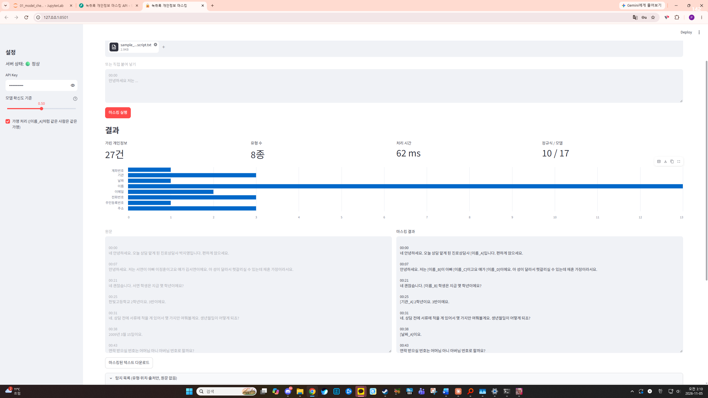

---

## 1. 프로젝트 소개

### 왜 만들었나

상담·면담·회의는 녹음해 두면 기록과 복기에 큰 도움이 되지만, "상대가 녹음을 꺼리는 경우가 많습니다." 거부감의 핵심은 녹음 자체보다 ""내 이름·연락처·사는 곳이 기록에 남고, 나중에 누군가에게 공유되거나 AI에 들어가서 내가 특정될 수 있다""는 걱정입니다.

녹음 → 텍스트 변환은 이미 스마트폰 기본 앱(갤럭시 녹음 앱)이 잘합니다. 비어 있는 것은 그다음 단계, ""변환된 텍스트를 공유하거나 외부 AI에 넣기 전에 개인정보를 확실히 지우는 일""입니다. 이 서비스는 그 빈칸을 채웁니다.

### 무엇을 하나

| 입력 | 출력 |
|---|---|
| `저는 서연이 아빠 이정훈이고요 얘가 김서연이에요.` | `저는 [이름_B]이 아빠 [이름_C]이고요 얘가 [이름_D]이에요.` |
| `네 제 번호로 해 주세요. 010-3847-2915입니다.` | `네 제 번호로 해 주세요. [전화번호_A]입니다.` |
| `연락처는 공일공 칠이육삼 사팔일오요.` (음성 변환이 숫자를 한글로 적은 경우) | `연락처는 [전화번호_B]요.` |
| `00:07` (타임스탬프 줄) | `00:07` (그대로 보존) |

- "가명 처리": 같은 사람은 같은 가명(`[이름_C]`)으로 바꿔서, 가린 뒤에도 "누가 무슨 말을 했는지 흐름이 유지"됩니다.
- "녹취록 형식 보존": 타임스탬프 줄과 빈 줄을 원래 자리에 그대로 둡니다.
- "응답과 로그에 원문 없음": 서버 응답·에러 메시지·로그 어디에도 개인정보 원문이 남지 않게 설계했습니다.

### 앞으로의 확장 방향

녹음과 동시에 마스킹된 텍스트가 자동으로 만들어지는 ""마스킹 녹음 앱"". 녹음이 필요하지만 상대의 거부감 때문에 어려웠던 상황(상담, 면담, 인터뷰)에서 권할 수 있는 도구가 목표입니다.

---

## 2. 시스템 아키텍처

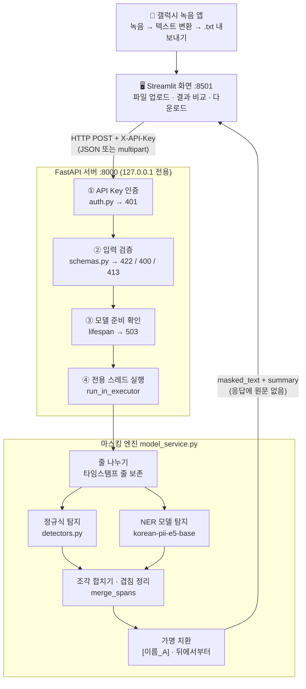

"요청 하나의 흐름": 인증(401) → 입력 검증(422 / 400 / 413) → 모델 준비 확인(503) → 전용 스레드에서 마스킹(실패 시 500) → 응답(200).
값싼 검사를 앞에 두어, 잘못된 요청은 모델에 닿기 전에 막습니다.

---

## 3. 각 부품 구성에 대한 설명

### 프로젝트 구조

```
transcript-pii-masker/
├── app/
│   ├── auth.py            # API Key 인증 (강의안 3.2절 재사용)
│   ├── schemas.py         # 입력·출력 규격 (Pydantic)
│   ├── detectors.py       # 규칙 부품: 타임스탬프 판별, 정규식 탐지, 조각 합치기
│   ├── model_service.py   # 모델 부품 + 전체 조립: 모델 로드, 탐지, 가명 치환
│   └── main.py            # FastAPI 서버
├── frontend/
│   └── app.py             # Streamlit 화면
├── samples/
│   ├── sample_transcript.txt   # 가상 상담 녹취록 (갤럭시 형식, 실제 인물 아님)
│   └── expected_pii.md         # 채점용 정답지 (가려야 할 25개 / 가리면 안 되는 것)
├── 01_model_check.ipynb   # 모델 비교 · 단계별 검증 · API 테스트 노트북
├── docs/images/           # 결과 스크린샷
└── requirements.txt
```

### 부품별 역할

| 단계 | 파일 | 하는 일 | 사용한 규약·도구 |
|---|---|---|---|
| 화면 | `frontend/app.py` | 파일 업로드 / 붙여 넣기 → API 호출 → 원문·결과 좌우 비교, 유형별 그래프, 결과 다운로드 | Streamlit, `requests`, `st.session_state` |
| 통신 | — | 화면과 서버가 HTTP로 대화. 텍스트는 JSON, 파일은 multipart/form-data | HTTP, REST, JSON |
| ① 인증 | `app/auth.py` | 헤더 `X-API-Key`를 확인. 없거나 틀리면 401 | FastAPI `Depends` (의존성 주입) |
| ② 입력 검증 | `app/schemas.py`, `main.py` | 글자 수(1~50,000), 공백만 있는 입력, `threshold` 범위(0~1)를 검사해 422. 파일은 확장자(400) → 크기(413) → "실제 UTF-8 디코딩"(400) 순서로 검사 | Pydantic `Field`, `@field_validator` |
| ③ 모델 준비 | `main.py` | 서버를 먼저 열고 모델은 뒤에서 로드. 로딩 중이면 `/health`는 `loading`, 요청은 503 | `lifespan`, `asyncio.create_task` |
| ④ 비동기 실행 | `main.py` | 무거운 모델 작업을 전용 스레드(일꾼 1명, GPU 1장 기준)에 맡겨 이벤트 루프가 멈추지 않게 함 | `run_in_executor`, `ThreadPoolExecutor` |
| 줄 나누기 | `model_service.py` | 갤럭시 파일을 줄 단위로 나눠 "발언 줄만" 탐지에 넣고, 타임스탬프·빈 줄은 그대로 보존 | 정규식 `^\d{1,2}:\d{2}(:\d{2})?$` |
| 정규식 탐지 | `app/detectors.py` | 형식이 정해진 것: 주민번호, 카드번호, 전화번호, 계좌번호, 이메일, "한글로 적힌 전화번호", "기관명(○○고등학교, ○○학원 등)" | Python `re` |
| 모델 탐지 | `model_service.py` | 형식이 없는 것: 이름, 주소, 날짜 등. 발언 줄을 묶어서(batch 16) 한 번에 처리 | transformers `pipeline("token-classification")` |
| 합치기 | `app/detectors.py` | 모델이 조각낸 결과(`'박지'`+`'영'`)를 합치고, 정규식·모델이 겹치면 "범위는 넓게(합집합), 라벨은 정규식 우선" | 직접 구현 `merge_spans` |
| 가명 치환 | `model_service.py` | 같은 (유형, 글자) → 같은 가명. "뒤에서부터" 바꿔 끼워 위치가 밀리지 않게 함. 가명 대응표는 함수 안에서만 쓰고 버림 | `Counter`, 사전 |

### 모델 선택: `FrameByFrame/korean-pii-e5-base`

| 항목 | 내용 |
|---|---|
| 태스크 | `token-classification` (토큰마다 개인정보 유형을 붙이는 개체명 인식) |
| 기반 모델 | `intfloat/multilingual-e5-base`, 약 0.3B 파라미터 |
| 학습 데이터 | 대화체 한국어 개인정보 데이터(KDPII) 포함 — "녹취록(대화체)에 맞음" |
| 라이선스 | MIT |

같은 가상 녹취록(발언 33줄, 정답 25개)으로 후보 두 모델을 비교했습니다.

| | "korean-pii-e5-base (채택)" | klue-roberta-small-ner-identified |
|---|---|---|
| 완전히 잡음 | "21 / 25" | 16 / 25 |
| 놓침 | 3 (기관명 2, 한글 전화번호) | 7 ("주소 전체", 같은 이름 반복 등) |
| 확신도 | 거의 전부 0.97~1.00 | 0.51~0.99로 들쭉날쭉 |
| 라이선스 | MIT | 명시 없음 |

채택한 모델은 결과를 `'박지' + '영'`처럼 "조각내서" 돌려줬지만(라벨 형식이 pipeline의 기본 묶기 방식과 달라서), 위치 숫자가 정확히 이어져 있어 "후처리 함수(`merge_spans`)로 해결"했습니다. 모델에 없는 "기관명"과 음성 변환 특유의 "한글 숫자 전화번호"는 정규식으로 보완했습니다.

### 핵심 설계 판단

1. "정규식 + 모델 하이브리드" — 형식이 고정된 번호는 규칙이 더 정확하고(모델은 주민번호를 "계좌번호"로 잘못 분류함), 이름·주소처럼 형식이 없는 것은 모델만 잡을 수 있습니다. 각자 잘하는 것을 맡겼습니다.
2. "놓치지 않는 쪽 우선 (재현율 > 정밀도)" — 개인정보 하나를 놓치면 사고지만, 하나 더 가리면 불편일 뿐입니다. 그래서 확신도 기준을 0.5로 낮게 두고, 겹친 탐지는 넓은 쪽으로 합칩니다. 기관 대표번호(02-123-4567)도 가려지는 것은 이 선택의 결과입니다.
3. "실패하면 확실히 실패 (fail-closed)" — 마스킹 도중 에러가 나면 "반쯤 가린 결과를 돌려주지 않고 500"으로 끝냅니다. 모르는 모델 라벨도 버리지 않고 `[기타개인정보]`로 가립니다.
4. "응답·에러·로그에 원문 없음"
   - 응답의 `entities`에는 유형·타임스탬프·출처만 담습니다(원문은 화면이 이미 가지고 있음).
   - FastAPI 기본 422 응답은 보낸 입력(`input`)을 그대로 돌려주는데, 이 서비스에선 그게 곧 개인정보라서 "직접 만든 핸들러로 `input`을 제거"했습니다.
   - 로그에는 글자 수·탐지 건수·처리 시간만 남기고, 에러도 "종류 이름만" 기록합니다(에러 메시지에 원문 조각이 섞일 수 있어서).
5. "이 PC 밖으로 나가지 않음" — 서버와 화면 모두 `127.0.0.1`에만 열고, Streamlit의 사용 통계 전송도 끕니다(`--browser.gatherUsageStats false`).

---

## 4. 결과

### 성능 (가상 녹취록 1건, 3분 35초 분량, 1,457자)

| 지표 | 결과 |
|---|---|
| 반드시 가려야 할 개인정보 | "25건 중 25건 가림" (모델 단독 21건 → 정규식 보완 후 25건) |
| 가리면 안 되는 일반 단어 (학년, 점수, 직업명, 일정 등) | "사라진 것 0건" |
| 오탐 | 1건 — 상담실 대표번호 (재현율 우선 설계상 허용) |
| 타임스탬프 줄 보존 | 33 / 33 |
| 처리 시간 | 약 95 ms (RTX 5070 Ti) |

> 평가 데이터가 "가상 녹취록 1건(25건)"뿐이라 일반화된 성능으로 볼 수는 없습니다. 아래 "한계"를 함께 봐 주세요.

### 결과 스크린샷

"Streamlit — 마스킹 결과 (원문 / 결과 비교)"


"Streamlit — 키 없이 실행 (401 안내) / 설정 변경 후 이전 결과 안내"
| | |
|---|---|
| 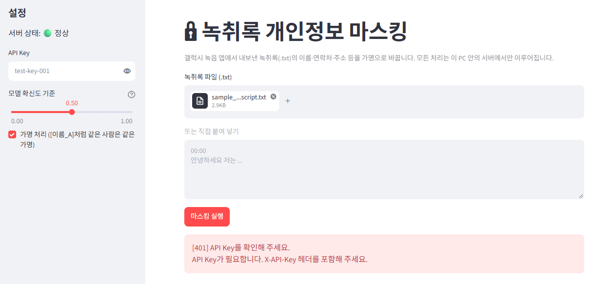 | 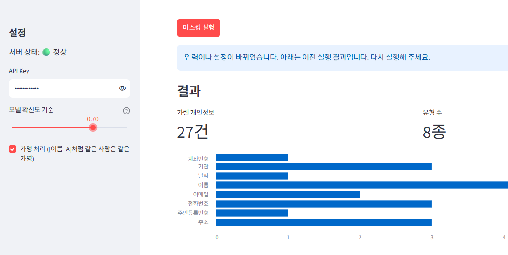 |

"탐지 목록 (유형·위치·출처만, 원문 없음)"
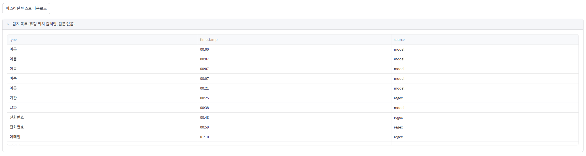

"API 자동 테스트 10종 — 전부 통과, 422 응답에 원문 없음 확인"
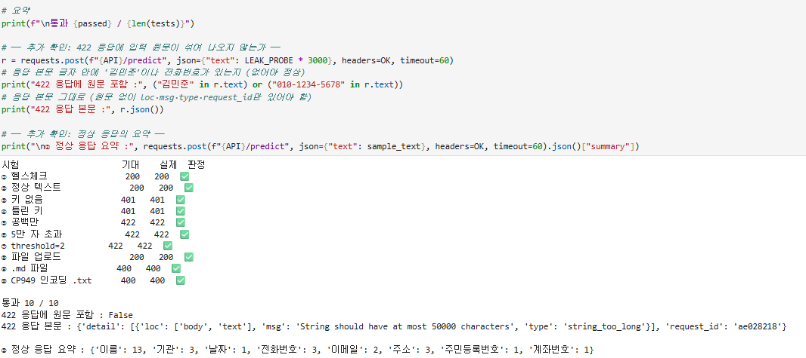

"Swagger UI"
| 헬스체크 (200) | 정상 마스킹 (200) |
|---|---|
| 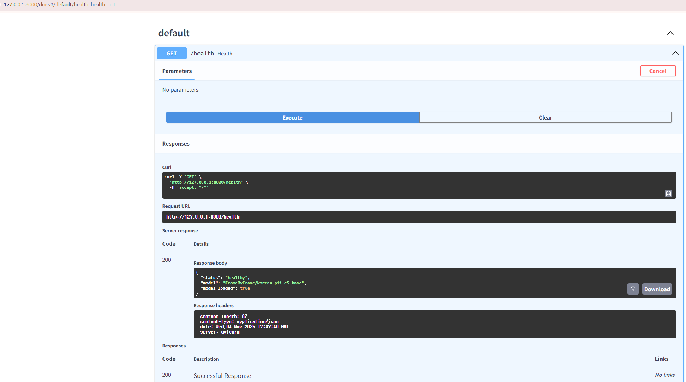 | 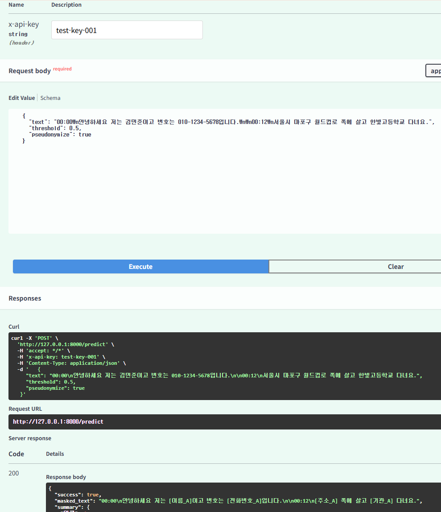 |
| "키 없음 (401)" | "틀린 키 (401)" |
| 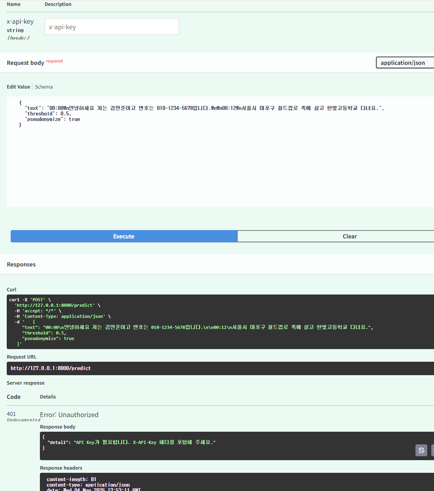 | 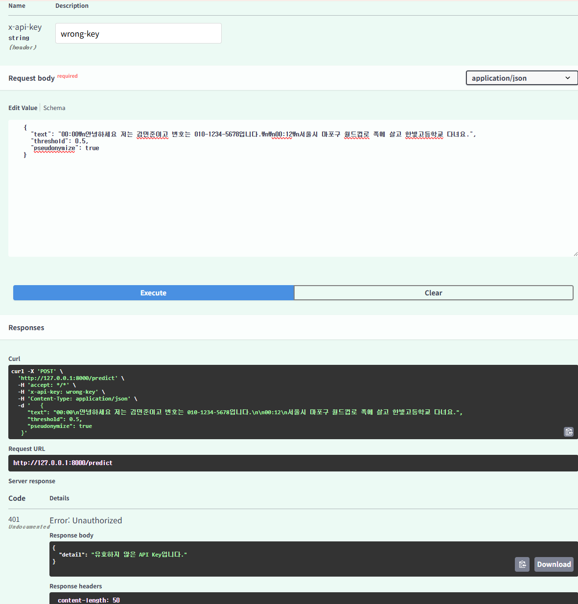 |
| "공백 입력 (422, `input` 없음)" | "파일 업로드 (200)" |
| 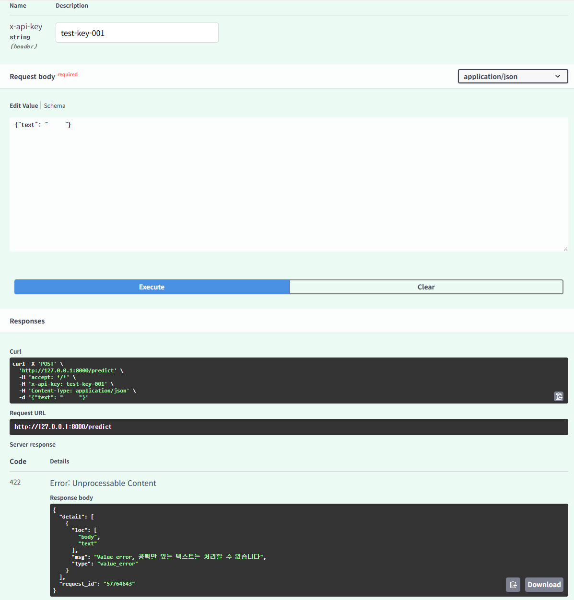 | 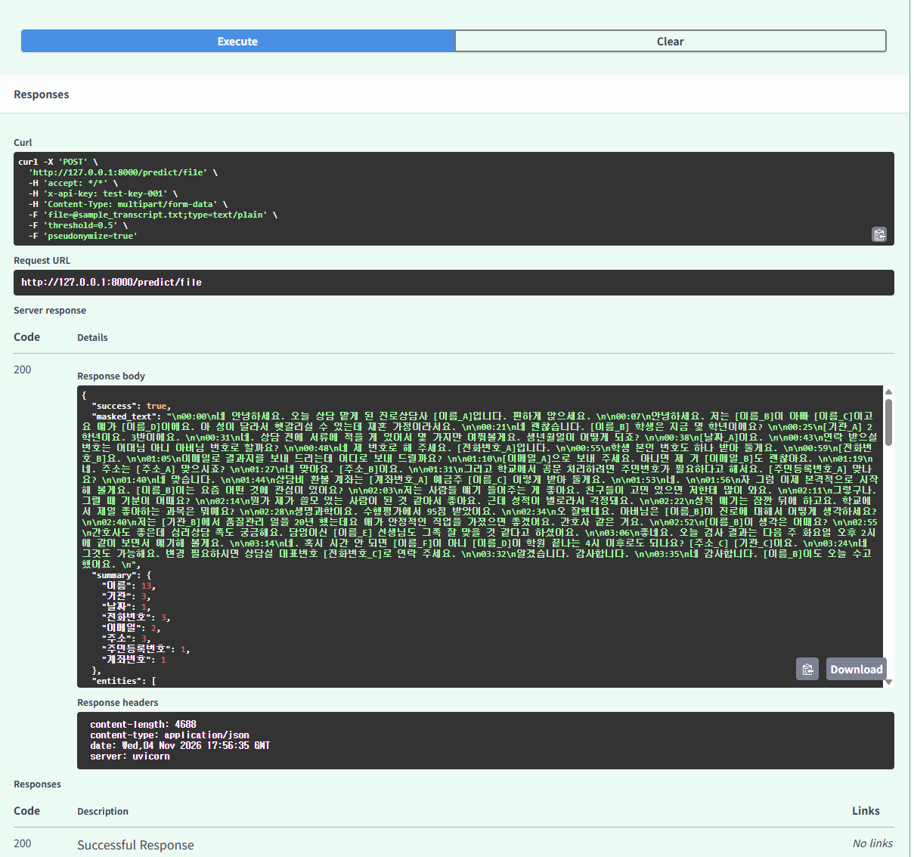 |
| ".md 파일 (400)" | "서버 로그 (원문 없음)" |
| 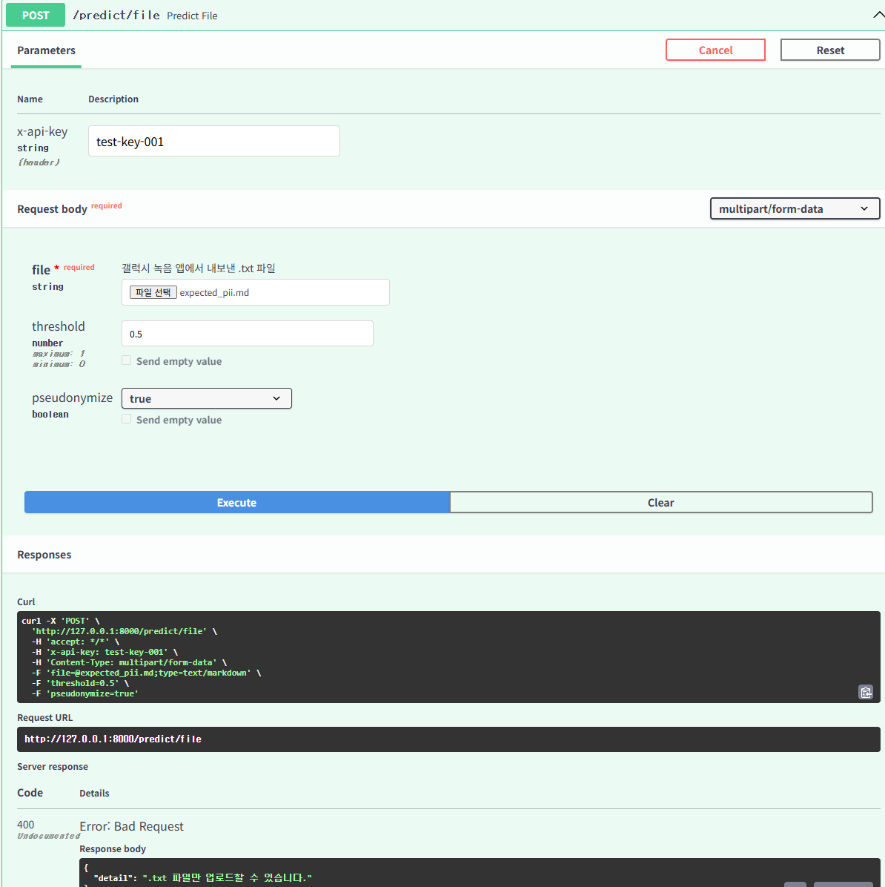 | 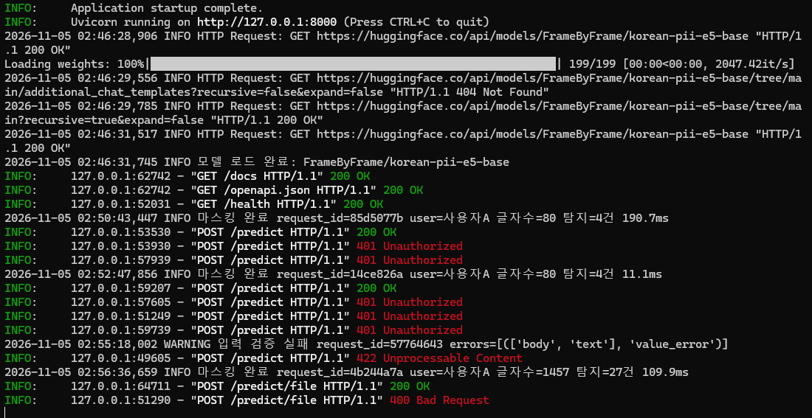 |

---

## 5. 실행 방법 (Windows PowerShell)

```powershell
# 1) 설치
cd ~\transcript-pii-masker
py -m venv .venv
.\.venv\Scripts\Activate.ps1
pip install torch --index-url https://download.pytorch.org/whl/cu128   # GPU (CPU만 쓸 경우 pip install torch)
pip install -r requirements.txt

# 2) 서버 (창 1) — 첫 실행 시 모델(수백 MB)을 허깅페이스에서 내려받음
uvicorn app.main:app --host 127.0.0.1 --port 8000

# 3) 화면 (창 2)
streamlit run frontend/app.py --server.port 8501 --server.address 127.0.0.1 --browser.gatherUsageStats false
```

- Swagger UI: http://127.0.0.1:8000/docs
- 화면: http://127.0.0.1:8501
- 시험용 API Key: `test-key-001`
- 모델을 로컬 경로로 바꾸려면 환경 변수 `PII_MODEL`에 경로를 지정 (코드 수정 불필요)

---

## 6. 한계와 보완점

"한계"
- "녹음 → 텍스트 변환 단계는 보호 범위 밖"입니다. 갤럭시의 텍스트 변환은 네트워크와 삼성 계정이 필요한 기능이라, 이 서비스는 "변환 이후의 공유·AI 입력"만 보호합니다.
- "평가 데이터가 가상 녹취록 1건(25건)" 입니다. 실제 상담 녹취는 사투리·말 끊김·음성 변환 오류가 훨씬 다양합니다.
- "같은 사람이 다른 가명이 되는 경우": "김서연"과 "서연", 음성 변환 오타 "김서현"은 서로 다른 가명이 됩니다(노출 문제는 아니고 읽기 편의의 한계).
- "간접 식별": 학교 + 학년 + 반처럼 하나하나는 개인정보가 아니어도 조합하면 특정되는 정보는 일부만 가립니다(학교명만 가림).
- "정규식의 범위": 한글 전화번호는 "공일공/영일영"으로 시작하는 휴대전화만, 기관명은 정해진 끝말(고등학교·학원·전자 등)만 잡습니다.
- 사람의 최종 검토를 대체하지 않습니다.

"실제 운영을 위한 보완점"
- API Key를 코드 밖(환경 변수)으로 빼고 해시로만 보관
- 모델을 로컬 경로에 고정하고 `HF_HUB_OFFLINE=1`로 외부 통신 0건 증명
- 동의를 받은 실제 녹취로 평가 세트 확대, "통과한 쪽" 표본 역검수
- 같은 사람 묶기(성 생략 이름·오타 이름 통합)
- Docker 패키징, 요청 제한(429)

---

## 7. 회고 (Keep · Problem · Try)

### Keep
- ""이게 실제로 쓸모 있나"를 먼저 따졌다." 처음 떠올린 "자기소개 감정 분석"은 결과가 실무에 의미가 없다고 판단해 버렸고, 음성 인식(Whisper)도 공개 비교 수치상 대화체 한국어에서 상용 서비스보다 오류가 많아 직접 만들지 않았다. 이미 잘하는 도구(갤럭시 녹음 앱)는 쓰고, 비어 있는 단계만 만들었다.
- "정답지를 먼저 만들고 시작했다." 가려야 할 25개와 가리면 안 되는 것을 미리 정해 두니, 모델 비교·정규식 보완·최종 결과를 모두 같은 숫자로 판단할 수 있었다.
- "한 단계씩 확인하며 조립했다." 모델 확인 → 스키마 → 규칙 부품 → 모델 부품 → 서버 → 화면 순서로, 단계마다 출력을 확인하고 넘어가서 문제가 생겨도 원인 위치가 분명했다.
- "지난 수업 내용을 실제로 적용했다." 비식별화(정규식+NER, 가명 처리), fail-closed, 422 응답의 원문 노출, 파일 업로드 검증, `run_in_executor`, `lifespan` 등 배운 것을 설계 근거로 썼다.

### Problem
- "주제를 정하는 데 시간이 오래 걸렸다." 실용성 검토를 아이디어를 고른 뒤에 해서, 주제를 두 번 바꿨다.
- "모델 출력 형태가 예상과 달랐다." 이름을 `'박지'+'영'`처럼 조각내서 돌려줘, 후처리를 따로 만들어야 했다.
- "평가가 가상 데이터 1건뿐이다." 실제 녹취에서 어느 정도 놓치는지는 아직 모른다.

### Try
- 아이디어를 고를 때 ""이미 더 잘하는 도구가 있는가 / 데이터는 어디서 오는가 / 결과를 어떻게 잴 것인가"" 세 질문을 먼저 확인한다.
- 모델을 정하기 전에 "실제 입력 형식 그대로 출력을 찍어 보는 단계"를 꼭 둔다(이번에 이 단계에서 조각 문제를 미리 발견했다).
- 동의를 받은 실제 녹취로 평가 세트를 늘리고, 놓친 유형을 정규식·후처리 규칙으로 되돌려 넣는 순환을 만든다.
- 오프라인 실행(`HF_HUB_OFFLINE=1`)과 소켓 감시로 "개인정보가 PC 밖으로 나가지 않는다"를 증명해 본다.

---

## 부록: 강의안 최종 체크포인트

1. "입력 검증" — 빈 텍스트, 공백만 있는 텍스트(`@field_validator`), 5만 자 초과, 범위 밖 `threshold`를 422로 막고, 파일은 확장자·크기·UTF-8 디코딩으로 400/413을 돌려준다. 422 응답에서는 입력 원문을 제거했다.
2. "인증 누락 위험" — 주소만 알면 누구나 서버 자원(GPU)을 쓰고, 개인정보가 담긴 녹취를 누가 넣었는지 추적할 수 없다. 이 서비스에서는 로그의 `user`가 추적의 근거다.
3. "run_in_executor를 쓴 이유" — 모델 추론은 오래 걸리는 동기 작업이라, `async def` 안에서 그냥 부르면 이벤트 루프가 멈춰 `/health`를 포함한 모든 요청이 막힌다. 전용 스레드에 맡기고 `await`로 양보했다.
4. "가장 많이 참고한 노트" — 비식별화(D41: 정규식+NER, 가명 처리), 인증과 화면(D49: `Depends`, 파일 업로드 검증, `session_state`), 비동기 처리(D48: `run_in_executor`, `lifespan`).
5. "사내 배포에 필요한 것" — 키의 코드 밖 보관·해시, 모델 로컬 고정과 외부 통신 차단, Docker 패키징, 게이트웨이의 요청 제한·헬스체크, 실제 데이터 기반 평가와 정기 역검수.
